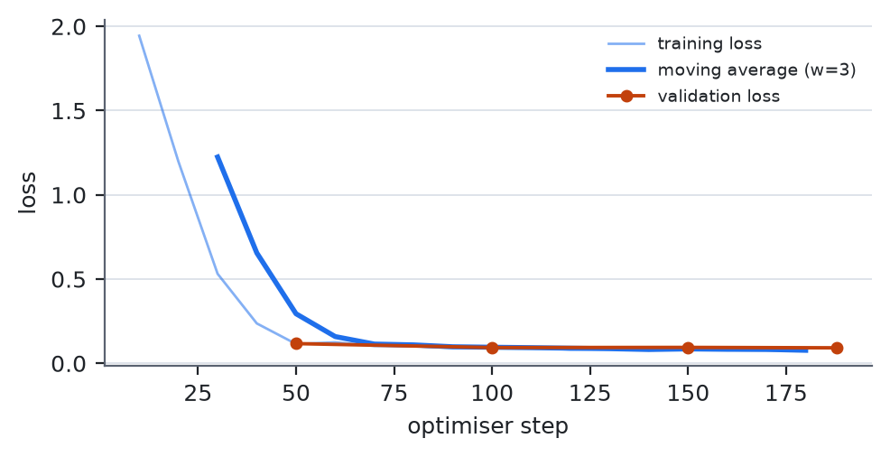
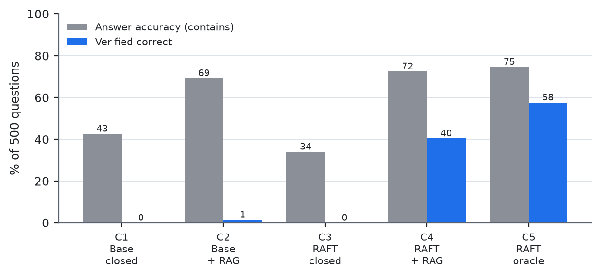
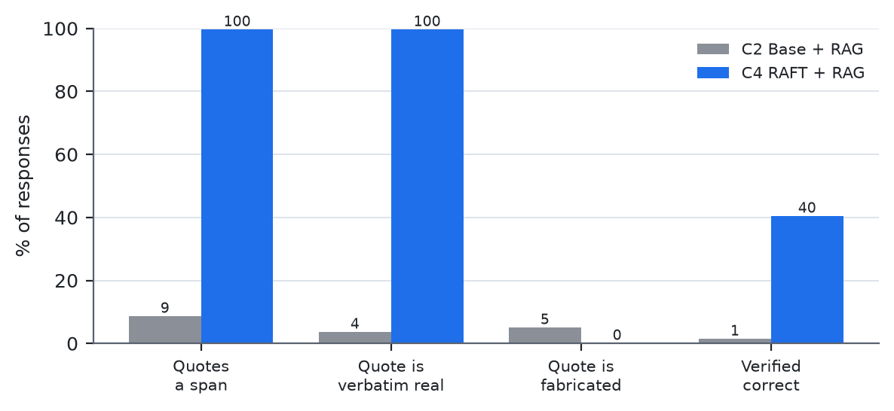
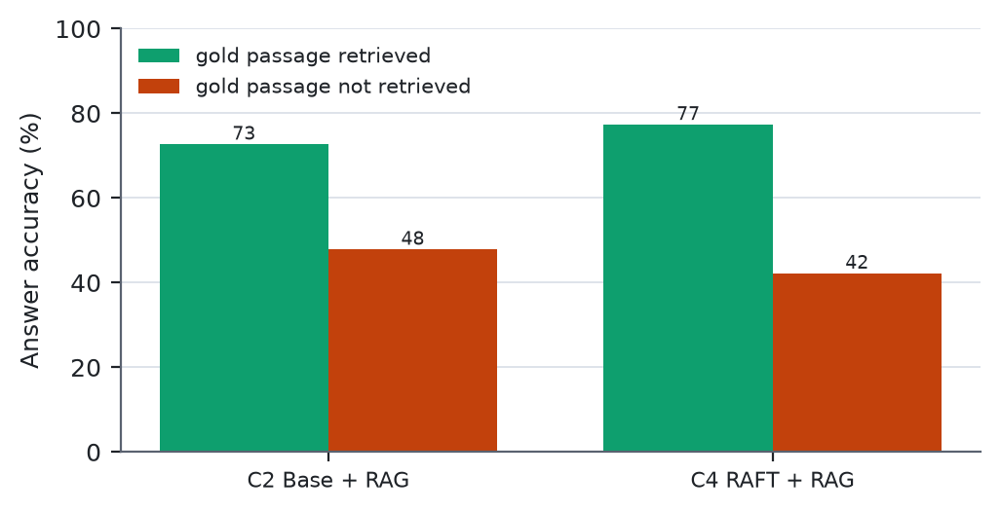
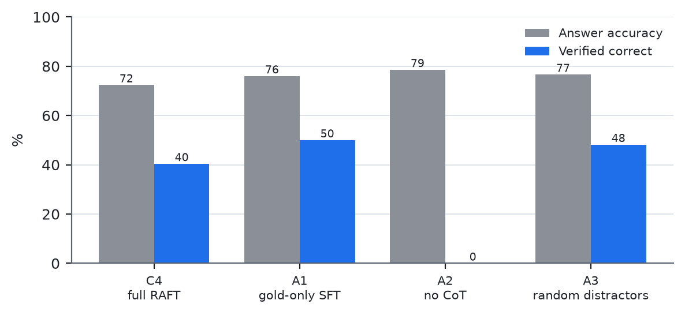

# Citation-grounded study support for adult online learners: adapting Retrieval-Augmented Fine-Tuning to a course corpus

**CP5403 Assessment 2 — LLM Project**

**GitHub repository:** {{GITHUB_URL}}

---

## Abstract

Retrieval-augmented generation (RAG) grounds a language model in course material but
optimises fluency rather than verifiability. For an adult learner studying online, an answer
that cannot be traced to a passage has little pedagogical value, and one drawn from a
topically adjacent but wrong passage is worse than none. This project adapts
Retrieval-Augmented Fine-Tuning (RAFT) to study support, fine-tuning a 1.5B-parameter model
with QLoRA to quote the supporting span verbatim and reject distractors; a learner-profile
channel for explanation depth did not take at this scale and is reported as a negative
result. On 500 held-out SciQ questions, the fine-tuned model with retrieval reaches
{{C4_CONTAINS}} answer accuracy against {{C2_CONTAINS}} for a prompted RAG baseline, and
raises the share of answers that are both correct and supported by a verifiable quotation
from {{C2_VERIFIED}} to {{C4_VERIFIED}}; fabricated citations fall from {{C2_FABRICATED}} to
{{C4_FABRICATED}}. The gain is in verifiability, not knowledge, and it does not extend to
source selection: the model cites the gold passage in only {{C4_GOLD_CITED}} of responses,
and when that passage is absent quotes a distractor rather than declining. Ablations
contradict the project's premise: chain-of-thought supervision produces the citations at a
measurable cost in accuracy, while the proposed hard-negative adaptation reduces both
accuracy and citation precision relative to gold-only fine-tuning ({{A1_VERIFIED}} against
{{C4_VERIFIED}}) and random distractors ({{A3_VERIFIED}}). The evaluation harness, not the
adaptation, is what this work contributes.

---

## 1. Introduction

Online enrolment has grown faster than the capacity to provide individual feedback.
Adult learners balance study with employment and care, study asynchronously, and often
lack the informal peer and tutor contact that on-campus students take for granted.
Addanki et al. (2020, 2022) describe a population whose engagement depends less on
content delivery than on the system's capacity to respond to the individual learner's
situation — the principle they term *academagogy* — and their later work proposes that
AI can personalise that experience if integrated through explicit design principles
rather than bolted on (Addanki, 2026; Addanki et al., 2025).

A conversational study assistant is the obvious vehicle, and RAG the obvious way to build
one: index the course reading, retrieve passages for the question, answer from them (Lewis et
al., 2020). RAG is effective but not sufficient. Retrieval errors are not random — a dense
retriever returns passages that are *topically* close, exactly the condition under which
models are most likely to be misled (Shi et al., 2023). A correct answer carries no
provenance, and a tutor who cannot be checked is a poor substitute for a textbook. And models
produce quotation marks even when no passage was supplied.

RAFT addresses the first and third problems directly: given a question and retrieved
documents, it trains the model to quote verbatim the sequence that answers the question
and discard the rest, coupled with a chain-of-thought response (Zhang et al., 2024).
The verbatim quotation is the key choice — it converts "did the model ground its
answer?" from a judgement call into a substring check.

This project asks whether that recipe transfers to an educational setting, and
whether it can carry a second, pedagogical signal. The contributions are:

1. An adaptation of RAFT in which distractors are *retrieved* hard negatives rather than
   random passages, so training matches a real retriever's failure mode. The evaluation finds
   this counter-productive (Section 5.4), which is itself a contribution: it is the ingredient
   most likely to be copied untested.
2. A learner-profile conditioning channel connecting the implementation to the academagogy
   literature, evaluated as a controlled variable rather than an aspiration.
3. An evaluation separating accuracy from citation quality, measuring grounding by verbatim
   substring verification, with ablations on distractor composition, chain-of-thought
   supervision and retrieval depth.

---

## 2. Target problem

### 2.1 Task formulation

Let *C* be a course corpus of passages, *q* a learner's question, and *π* a learner
profile. A retriever returns *D = top-k(q) ⊂ C*. The system must produce a response
*r* consisting of a reasoning trace *ρ* and an answer *a*, such that *ρ* contains at
least one span *e* quoted verbatim from some *d ∈ D*, and *a* is correct with respect
to *d*. Five requirements follow, each separately measurable:

- **R1 Correctness.** *a* matches the reference answer.
- **R2 Verifiability.** Every quoted span *e* occurs literally in the document it is attributed
  to — checkable by substring search, and the property that makes the answer usable by a
  learner.
- **R3 Distractor robustness.** Topically adjacent but non-supporting passages must not change
  *a*, and must not supply *e*.
- **R4 Calibrated depth.** Depth should track *π* without degrading *a*.
- **R5 Abstention.** When *D* contains no supporting passage, the system should say so rather
  than confabulate.

R2 is what distinguishes this task from ordinary open-domain QA, and it is why RAFT
is the appropriate technique: the training signal is constructed so that quoting the
wrong document is directly penalised.

### 2.2 Why the problem is non-trivial here

*Retrieval failure is common.* The gold passage appears in the retrieved top-5 for
{{RECALL5_PC}} of questions; for the remaining {{MISS_RATE}}, no amount of generation
quality can produce a grounded correct answer. The system is therefore evaluated
end-to-end under a ceiling it does not control, which is why accuracy is reported
separately for the gold-retrieved and gold-missing subsets.

*Distractors are adversarially similar.* The corpus is science textbook prose, so a
retriever's near-misses are often about the same structure or quantity as the question;
telling "the passage that mentions neutrophils" from "the passage that defines what
neutrophils exemplify" requires more than lexical matching.

*The model is small.* A single 8 GB GPU rules out a 7B model at usable throughput, so
the base is Qwen2.5-1.5B-Instruct (Yang et al., 2024). A 1.5B model follows instructions
loosely, and ignores the requested output format roughly a third of the time, so any
gain has to survive a format problem as well as a knowledge problem.

### 2.3 Scope

The system handles single-turn factual questions against a static corpus. It does
not maintain dialogue state, diagnose misconceptions across a sequence of attempts,
or sequence a curriculum. The learner profile is a three-level synthetic construct
rather than an inferred user model; Section 6 discusses what that costs.

---

## 3. Choice of data sources

### 3.1 Question and evidence data

SciQ (Welbl et al., 2017) is 13.7k crowdsourced multiple-choice science questions, each with a
*support* passage — the excerpt the question was written from — and four options. Two properties
made it the right choice. The support passage is a **per-question gold evidence document**, and
most QA datasets supply answers but not the span that justifies them; without gold evidence R2
cannot be measured and RAFT's mechanism cannot be trained or evaluated. And the domain is genuine
educational content at school and introductory undergraduate level, closer to the intended
application than Wikipedia-based benchmarks or the biomedical corpora of the original RAFT work.
The published split was used: 11,679 / 1,000 / 1,000.

### 3.2 Corpus construction

The retrieval corpus is the union of unique *support* passages across all three splits:
{{N_PASSAGES}} passages totalling {{TOTAL_TOKENS}} tokens, mean length {{MEAN_TOKENS}}. This is
deliberate: homogeneity with the task means every passage is expository science prose of the
kind a reading list contains, so retrieval difficulty is realistic. The cost is that the same
passages serve as corpus and gold evidence, so Recall@k here is optimistic relative to a
corpus of lecture transcripts and forum threads (Section 6.2).

Two filters were applied. Passages shorter than five words were discarded as
degenerate. More importantly, {{EMPTY_RATE}} of SciQ test items have an empty
*support* field, making them unanswerable from the corpus by construction; retaining
them would have depressed every condition equally and added noise, so they were
excluded from the evaluation pool, leaving {{POOL_TEST}} answerable questions of
which {{N_TEST}} were sampled.

### 3.3 Learner profiles

Three profiles — *novice*, *intermediate* and *advanced* — differ in prior knowledge,
goal and requested explanation depth. They are synthetic prompts, not measurements
of real learners: the profiles test whether the model *can* condition on a stated
preference, not whether the preference is correctly inferred.

### 3.4 Ethics and licensing

SciQ is publicly released for research use. No personal or learner-identifiable data
was collected or processed. The base model is Apache-2.0 and the embedding model
MIT-licensed.

---

## 4. Methodology

### 4.1 Retrieval

Passages are encoded with `bge-small-en-v1.5`, a 384-dimensional bi-encoder, using
the asymmetric query instruction the model was trained with. Similarity is cosine,
computed as a normalised inner product. With {{N_PASSAGES}} passages the index is
small enough that exact search costs a few milliseconds per query, so no approximate
index was used; this removes ANN recall as a confound. Retrieval quality on the
evaluation set is Recall@1 = {{RECALL1}}, Recall@5 = {{RECALL5}}, MRR = {{MRR}}.

### 4.2 RAFT data construction

The recipe follows Zhang et al. (2024). Each training sample contains one gold
document and four distractors, and the gold document is retained for a proportion
*P* = 0.8 of samples; in the remaining 20% only distractors are supplied. That second
case forces the model to answer from parametric knowledge instead of learning that an
answer is always present, which is what makes R5 achievable. Two adaptations were
made.

**Distractors are retrieved hard negatives.** The original recipe samples distractors
at random, training robustness to noise but not to the noise a retriever actually
produces. Here, two of the four distractors are the highest-scoring non-gold passages
for that question and two are random, matching the training distribution to the
inference distribution. Section 5.4 isolates the effect.

**Chain-of-thought targets are constructed programmatically.** Zhang et al. (2024)
generate reasoning traces with GPT-4. Without external API access, and with a premium
on reproducibility, the targets here are rendered from templates conditioned on the
gold evidence. For a question whose answer appears literally in the gold passage, the
template quotes the containing sentence:

```
##Reason: Passage [4] is the relevant source: ##begin_quote## White blood cells
—including neutrophils, monocytes, lymphocytes, eosinophils, and basophils—are
involved in the immune response. ##end_quote## This states the relationship the
question asks about, which identifies the answer as white blood cell. The
remaining passages are about other topics and cannot support an answer here.
##Answer: white blood cell
```

For the {{NO_QUOTE_RATE}} of items where the answer is present but not literally quotable, the
template emits **no** quote marker and phrases the reasoning as inference. This is not
cosmetic: if the target contained a fabricated quotation, the grounding metric would be
measuring the template rather than the model. Surface realisation varies across a small set of
templates to limit over-fitting, at the cost of traces less diverse than model-generated ones —
the project's largest methodological weakness (Section 6.2).

### 4.3 Prompt design and learner-profile conditioning

The prompt is a system message plus one user message containing a `<learner_profile>` block, a
`<course_passages>` block with numbered passages, the question, and a format specification
requiring `##Reason:` and `##Answer:`. It is byte-identical between training and inference; the
closed-book condition substitutes "(none available)" for the passage block, which is
in-distribution because the 20% no-gold samples use exactly that form. An early implementation
that passed a flat string made the model continue the passages instead of answering, producing
plausible-looking but meaningless baselines until it was caught.

### 4.4 QLoRA fine-tuning

The base model is loaded in 4-bit NF4 with double quantisation, and LoRA adapters (r = 16, α =
32, dropout 0.05) are applied to all linear projections: {{TRAINABLE}} trainable parameters,
{{TRAINABLE_PCT}} of the model. Training uses paged 8-bit AdamW, gradient checkpointing,
learning rate 2e-4 with a cosine schedule, one epoch over {{N_TRAIN}} examples, effective batch
size 16, and maximum sequence length 1152. Peak allocated memory was 6.87 GB, measured rather
than estimated. A second epoch was not run: loss fell from 1.95 to 0.24 within the first fifth
of the epoch, which is itself informative about the targets (Section 6.2).

Loss is computed on target tokens only; prompt tokens are masked to −100. With
prompts averaging {{PROMPT_TOKENS}} tokens and targets averaging {{TARGET_TOKENS}}
tokens, {{PROMPT_SHARE}}% of each sequence is instruction and context. Training on
those tokens would dilute the signal that matters.



### 4.5 Experimental conditions

Table 1. Experimental conditions.

| ID | Condition | Retrieval | Fine-tuned |
|---|---|---|---|
| C1 | Base, closed-book | none | no |
| C2 | Base + RAG | top-5 retrieved | no |
| C3 | RAFT, closed-book | none | yes (RAFT) |
| C4 | RAFT + RAG | top-5 retrieved | yes (RAFT) |
| C5 | RAFT, oracle context | gold passage + 4 retrieved | yes (RAFT) |
| A1 | SFT control (gold only) | top-5 retrieved | yes (no distractors) |
| A2 | RAFT without CoT | top-5 retrieved | yes (answer-only targets) |
| A3 | RAFT, random distractors | top-5 retrieved | yes (random distractors) |

C1–C4 form the main comparison. C5 isolates the effect of retrieval failure by
supplying the gold passage. A1–A3 decompose the treatment: whether fine-tuning on the
domain alone suffices, whether chain-of-thought supervision matters, and whether
distractor hardness matters.

### 4.6 Metrics

*Answer accuracy.* Normalised exact match and token-level F1 against the reference
answer, following SQuAD conventions, plus a lenient *contains* metric — whether the
normalised gold answer occurs in the prediction. *Contains* is the headline figure
because it is insensitive to verbosity, which RAFT training reduces and which would
otherwise inflate the apparent advantage.

*Citation quality.* `quote_rate` is the share of responses containing at least one
quoted span; `grounded_rate`, the share whose quotations all occur verbatim in a
supplied passage; `fabricated_rate`, the share quoting a span that occurs in no
supplied passage — the failure mode R2 exists to prevent; `gold_cited_rate`, the
share quoting the gold passage.

*Verified correctness.* The share of responses that are both correct (*contains*) and
supported by a quotation from the gold passage — an answer a learner can check.

*Cost.* Output tokens and wall-clock latency per query, on the same GPU.

---

## 5. Evaluation

### 5.1 Retrieval

The retriever alone recovers the gold passage at rank 1 for {{RECALL1_PC}} of
evaluation questions and within the top 5 for {{RECALL5_PC}}, with MRR {{MRR}}. The
top-5 figure sets the ceiling for C2 and C4: {{MISS_RATE}} of questions cannot be
answered from retrieved context regardless of generation quality.

### 5.2 Main comparison

Table 2. Main comparison on the 500-question held-out set. Accuracy columns are percentages; the last two columns report cost.

{{TABLE_MAIN}}



Adding retrieved passages (C1 → C2) raises *contains* accuracy from {{C1_CONTAINS}}
to {{C2_CONTAINS}} — the expected RAG gain, and a large one.

Fine-tuning without retrieval (C3) does not reproduce it, and its failure is more informative
than a success would have been. C3 scores {{C3_CONTAINS}} on *contains*, below the baseline, but
{{C3_EM}} on exact match, above it: fine-tuning made the model terse. The base model writes a
sentence that happens to mention the answer ({{C1_CONTAINS}} *contains* against {{C1_EM}} exact
match); the fine-tuned model writes the answer and stops, abstaining in {{C3_ABSTAIN}} of cases,
with fabricated citations down from {{C1_FABRICATED}} to {{C3_FABRICATED}}. Domain adaptation
buys format discipline, not knowledge.

C4 is the best condition on every accuracy metric: {{DELTA_C4_C2}} points of
*contains*, {{C2_EM}} → {{C4_EM}} exact match, {{C2_VERIFIED}} → {{C4_VERIFIED}}
verified correctness. Citation behaviour is where the difference is starkest. The
prompted baseline quotes in {{C2_QUOTE}} of responses but grounds only
{{C2_GROUNDED}} — most of its citations are invented. C4 quotes in {{C4_QUOTE}},
grounds {{C4_GROUNDED}}, and fabricates {{C4_FABRICATED}}; format compliance rises
from {{C2_FORMAT}} to {{C4_FORMAT}}, which is what makes the output
machine-checkable at all.



**Grounding is not selection.** A quotation that exists is not necessarily the one that answers
the question. C4 cites the gold passage in {{C4_GOLD_CITED}} of responses and some other supplied
passage in {{C4_DISTRACTOR}}; the two rates sum to the quote rate, so it quotes exactly one
passage, and about half the time not the one SciQ designates as gold. Not all of that is error:
61.4% of responses citing a non-gold passage still answer correctly, since SciQ assigns one
support passage per question while the corpus holds others that bear on it. Verified correctness
is therefore a **lower bound** between {{C4_VERIFIED}} and {{C4_GROUNDED}}.

C5, with the gold passage guaranteed, sets the ceiling retrieval failure prevents C4 from
reaching. *Contains* rises only to {{C5_CONTAINS}}, {{GAP_C4_C5}} points above C4, because C4
already recovers much from parametric knowledge when retrieval misses; verified correctness rises
much further, {{C4_VERIFIED}} → {{C5_VERIFIED}}, because without the gold passage in context the
model cannot cite it. Even under oracle retrieval it cites gold in only {{C5_GOLD_CITED}} of
responses: source selection, not grounding, is the binding constraint.

### 5.3 Where the gain comes from

Table 3. Accuracy split by whether the gold passage was retrieved.

{{TABLE_GOLD_SUBSET}}



Splitting by retrieval success is the most informative analysis here, and it partly
contradicts the design hypothesis. With the gold passage present C4 is ahead of C2
({{C4_CONTAINS_GOLD}} against {{C2_CONTAINS_GOLD}}); with it absent C4 is *behind*
({{C4_CONTAINS_MISS}} against {{C2_CONTAINS_MISS}}).

The 20% of samples with no gold passage were meant to teach abstention in exactly this
situation. They did not: C4 abstains in {{C4_ABSTAIN}} of responses overall, and on the
gold-absent subset quotes a distractor in 98.6% of them. What those samples did achieve
is the suppression of fabrication — the model no longer invents quotations, but it will
attach a real quotation to a wrong conclusion.

### 5.4 Ablations

Table 4. Ablations. A1 removes the distractors, A2 removes the chain-of-thought supervision, A3 replaces retrieved hard negatives with random passages.

{{TABLE_ABLATION}}



The ablations do not support the hypothesis this project was built on, and they are
the most informative result in it.

*A2 — does the chain-of-thought matter?* Decisively. Training on the answer alone gives the
highest raw accuracy in the study, {{A2_CONTAINS}}, and no citations at all: {{A2_QUOTE}} of
responses contain a quoted span, because the model emits the answer and stops after
{{A2_TOKENS}} tokens. Chain-of-thought supervision therefore *costs* accuracy and *buys*
verifiability — a trade, not a free lunch.

*A1 — is RAFT better than plain domain SFT?* No. A model fine-tuned with one gold
passage and no distractors scores {{A1_CONTAINS}} on *contains* and {{A1_VERIFIED}} on
verified correctness, against C4's {{C4_CONTAINS}} and {{C4_VERIFIED}}, cites the gold
passage more often ({{A1_GOLD_CITED}} against {{C4_GOLD_CITED}}) and quotes a distractor
less often ({{A1_DISTRACTOR}} against {{C4_DISTRACTOR}}).

*A3 — does distractor hardness matter?* It matters, in the wrong direction: random
passages give {{A3_CONTAINS}} and {{A3_VERIFIED}}, against {{C4_CONTAINS}} and
{{C4_VERIFIED}}. Harder negatives were the worse training signal — gold-only
{{A1_VERIFIED}}, random {{A3_VERIFIED}}, retrieved hard negatives {{C4_VERIFIED}}.

A1 is not a single-variable comparison: its corpus also lacks the no-gold samples and the
four-document context, so it is evidence against the *package*. A3 is the cleaner test,
holding document count and gold-present rate fixed and changing only the identity of the
distractors, and it too favours the simpler condition.

A mechanism is plausible, offered as hypothesis. The template names the rejected passages
("Passages 1, 3, 4, 5 do not address this question"); with hard negatives in context the
model may learn to discuss nearly-relevant passages rather than ignore them, which would
appear as the higher distractor-citation rate. If so, the fix is a target that never names
them.

### 5.5 Retrieval depth

Table 5. Retrieval-depth sweep for the fine-tuned model.

{{TABLE_TOPK}}

{{TOPK_VERDICT}}

This is the cleanest evidence for the source-selection account, because depth is
manipulated while everything else is fixed. One passage to five does not change what the
model knows; it changes how many candidate quotations are in front of it, and every extra
candidate is another chance to quote something topically adjacent. A study assistant
should therefore retrieve narrowly, and rerank rather than widen the generator's context.

### 5.6 Learner-profile conditioning

Table 6. Learner-profile sweep. Only the profile block changes between rows.

{{TABLE_PROFILE}}

Varying only the profile block, with everything else fixed, moves mean output length
from {{PROF_NOVICE_TOKENS}} tokens under the novice profile to
{{PROF_ADVANCED_TOKENS}} under the advanced profile, and accuracy from
{{PROF_NOVICE_CONTAINS}} to {{PROF_ADVANCED_CONTAINS}}. {{PROFILE_VERDICT}}

### 5.7 Cost

C4 costs {{C4_TOKENS}} output tokens and {{C4_LATENCY}} s per query against
{{C2_TOKENS}} tokens and {{C2_LATENCY}} s for C2. On a single 8 GB GPU this supports
roughly {{THROUGHPUT}} queries per second — adequate for asynchronous study support,
not for live classroom use.

---

## 6. Discussion

### 6.1 What the results support

The central claim — that RAFT converts an unverifiable RAG answer into a checkable one — is
supported in two independent parts: verifiability went from {{C2_GROUNDED}} to {{C4_GROUNDED}},
and correctness conditional on verifiability from {{C2_VERIFIED}} to {{C4_VERIFIED}}. Neither is
obtainable by prompting. The gap between them is source selection, though not all of it is error:
61.4% of responses citing a non-gold passage answer correctly, so part of the distance is the
rigidity of a single-gold label; the rest is genuine, since a model that grounds {{C4_GROUNDED}}
of its quotations but cites gold in {{C4_GOLD_CITED}} is choosing what to quote, fluently enough
to look authoritative.

The ablations then split the recipe into a part that works and a part that does not, and the
split is not the one predicted. Chain-of-thought supervision makes the output checkable;
distractor exposure does not improve discrimination, and harder negatives make it worse. The
stated contribution was the hard-negative adaptation, and the evaluation shows it was the one
ingredient that cost performance. That is uncomfortable, but it is why the rest of the numbers
are credible: the harness that reports the gain locates its source, and the source is not the
part I proposed.

Together these describe what such a model can be trusted to do: quote something real,
not to have chosen the right passage, and not to decline. A deployed system would need a
verification layer checking that the quoted span entails the answer, which the verbatim
format makes cheap.

### 6.2 Limitations

*Synthetic reasoning traces.* The targets are templated, not generated by a stronger model:
consistent and grounded, but repetitive, so the model has plausibly learned the template's
discourse as much as the discrimination. It learned to quote because the targets always quoted
verifiable spans, which is weaker than learning when quoting is appropriate. The training curve
agrees: loss fell from 1.95 to 0.24 within the first fifth of one epoch, the profile of a model
fitting a predictable surface form.

*Corpus and task overlap.* Using SciQ support passages as both corpus and gold evidence
makes retrieval easier than over a real course site, and the questions are exam-style
rather than the open-ended questions learners ask. Recall@k is an upper bound.

*Single-gold labels.* SciQ assigns one support passage per question, but the corpus holds others
that bear on the same fact and sometimes state it more precisely. Verified correctness counts a
citation to any of them as a failure, so it is a lower bound; adjudicating the non-gold citations
by hand would show how much of {{C4_GOLD_CITED}} is label rigidity.

*Single dataset, single model, single seed.* No confidence intervals; each condition was
run once. C2 versus C4 is a large enough gap to be unlikely to be noise, but the smaller
differences among ablations are indicative only.

*Synthetic learner profiles.* The profiles are stated, not inferred, and Section 5.6 found no
usable effect: {{PROF_NOVICE_TOKENS}} versus {{PROF_ADVANCED_TOKENS}} output tokens is not a
conditioning signal. Two explanations fit and this experiment does not separate them — the
targets were templated at one depth, and a 1.5B model may lack the capacity to hold a stylistic
instruction alongside a grounding task. No human evaluation was run, so whether any of this
helps a learner is untested.

### 6.3 Implications for practice

Two implications follow. The citation is not decoration: it makes the output usable, and it has
to be trained rather than requested, because prompting alone produces fabricated citations at a
high rate. And the profile channel did not work at this scale: a presentation layer is still the
right architecture, but it needs depth-varied training targets rather than a sentence in the
prompt. The link to academagogy is real but partial — Addanki's framework concerns the whole
learner situation, whereas this implementation attempted one narrow slice and the model declined
to condition on it.

---

## 7. Conclusion

This project adapted Retrieval-Augmented Fine-Tuning to a course-grounded study assistant and
evaluated it against a prompted RAG baseline on 500 held-out science questions. Fine-tuning with
retrieval raised answer accuracy from {{C2_CONTAINS}} to {{C4_CONTAINS}} and verified correctness
— answers both right and traceable to a quotation — from {{C2_VERIFIED}} to {{C4_VERIFIED}},
cutting fabricated citations from {{C2_FABRICATED}} to {{C4_FABRICATED}}. The gain is in
verifiability rather than knowledge: the model grounds {{C4_GROUNDED}} of its quotations but
selects the gold passage only {{C4_GOLD_CITED}} of the time, so the binding constraint has moved
from fabrication to source selection. The abstention the recipe was meant to teach did not
transfer.

The ablations are less flattering than the headline. Chain-of-thought supervision, not
distractor exposure, is what produces the citations, and the retrieved hard-negative
distractors that were this project's proposed adaptation performed worse than gold-only
fine-tuning ({{A1_VERIFIED}} against {{C4_VERIFIED}}) and worse than random distractors
({{A3_VERIFIED}}).

The main threats to validity are the templated traces, the single-gold labels that make verified
correctness a lower bound, and the single dataset. The most useful next steps are a reranker over
a narrow candidate set, a target template that never names the distractors, and a no-gold
objective that produces abstention. The evaluation harness — particularly the verbatim grounding
check — is the part most likely to transfer.

---

## References

Addanki, K. (2023). *Enhancing learning management systems to support online
learning using academagogy* [Doctoral thesis, James Cook University].

Addanki, K. (2026). Academagogy design principles for integrating AI to
personalise adult learner experiences in blended learning. *HERDSA 2026
Conference*.

Addanki, K., & Corrin, L. (2023). Unveiling the potential of digital twin
technology for higher education. In *Proceedings of the Australasian Society for
Computers in Learning in Tertiary Education (ASCILITE)* (pp. 12–21).

Addanki, K., Holdsworth, J., Hardy, D., & Myers, T. (2020). Academagogy for
enhancing adult online learner engagement in higher education. In *Proceedings of
the AIS SIGED International Conference on Information Systems Education and
Research*.

Addanki, K., Holdsworth, J., Hardy, D., & Myers, T. (2022). A preliminary study
using academagogy to uncover the problems that block adult online learner
engagement. In *Proceedings of the Australasian Computing Education Conference*
(pp. 95–104). ACM.

Addanki, K., Holdsworth, J., Hardy, D., & Myers, T. (2025). Integrating artificial
intelligence and academagogy to personalize adult learner experiences: A
comparative analysis. In *Proceedings of the International Conference on
Information Systems Education and Research*.

Asai, A., Wu, Z., Wang, Y., Sil, A., & Hajishirzi, H. (2024). Self-RAG: Learning
to retrieve, generate, and critique through self-reflection. In *Proceedings of
the International Conference on Learning Representations (ICLR)*.

Dettmers, T., Pagnoni, A., Holtzman, A., & Zettlemoyer, L. (2023). QLoRA:
Efficient finetuning of quantized LLMs. In *Advances in Neural Information
Processing Systems (NeurIPS)*.

Es, S., James, J., Espinosa-Anke, L., & Schockaert, S. (2024). RAGAS: Automated
evaluation of retrieval augmented generation. In *Proceedings of the Conference of
the European Chapter of the Association for Computational Linguistics (EACL):
System Demonstrations*.

Gao, Y., Xiong, Y., Gao, X., Jia, K., Pan, J., Bi, Y., Dai, Y., Sun, J., & Wang,
H. (2024). Retrieval-augmented generation for large language models: A survey.
*arXiv preprint arXiv:2312.10997*.

Hu, E. J., Shen, Y., Wallis, P., Allen-Zhu, Z., Li, Y., Wang, S., Wang, L., &
Chen, W. (2022). LoRA: Low-rank adaptation of large language models. In
*Proceedings of the International Conference on Learning Representations (ICLR)*.

Karpukhin, V., Oğuz, B., Min, S., Lewis, P., Wu, L., Edunov, S., Chen, D., & Yih,
W. (2020). Dense passage retrieval for open-domain question answering. In
*Proceedings of the Conference on Empirical Methods in Natural Language Processing
(EMNLP)* (pp. 6769–6781).

Lewis, P., Perez, E., Piktus, A., Petroni, F., Karpukhin, V., Goyal, N., Küttler,
H., Lewis, M., Yih, W., Rocktäschel, T., Riedel, S., & Kiela, D. (2020).
Retrieval-augmented generation for knowledge-intensive NLP tasks. In *Advances in
Neural Information Processing Systems (NeurIPS)* (pp. 9459–9474).

Liu, N. F., Lin, K., Hewitt, J., Paranjape, A., Bevilacqua, M., Petroni, F., &
Liang, P. (2024). Lost in the middle: How language models use long contexts.
*Transactions of the Association for Computational Linguistics, 12*, 157–173.

Shi, F., Chen, X., Misra, K., Scales, N., Dohan, D., Chi, E., Schärli, N., & Zhou,
D. (2023). Large language models can be easily distracted by irrelevant context.
In *Proceedings of the International Conference on Machine Learning (ICML)*.

Welbl, J., Liu, N. F., & Gardner, M. (2017). Crowdsourcing multiple choice science
questions. In *Proceedings of the Workshop on Noisy User-generated Text (W-NUT)*
(pp. 94–106). Association for Computational Linguistics.

Yang, A., Yang, B., Zhang, B., Hui, B., Zheng, B., Yu, B., Li, C., Liu, C., Huang,
C., Wei, C., et al. (2024). *Qwen2.5 technical report*. arXiv preprint
arXiv:2412.15115.

Yu, W., Zhang, H., Pan, X., Ma, K., Wang, H., & Yu, D. (2024). Chain-of-note:
Enhancing robustness of retrieval-augmented language models. In *Findings of the
Association for Computational Linguistics: EMNLP 2024*.

Zhang, T., Patil, S. G., Jain, N., Shen, S., Zaharia, M., Stoica, I., & Gonzalez,
J. E. (2024). RAFT: Adapting language model to domain specific RAG. *arXiv
preprint arXiv:2403.10131*.

---

## Appendix A — Declaration of AI-Generated Material

Generative artificial intelligence was used in the preparation of this assessment
item. In accordance with the subject's policy, the use is declared below and the
full prompt history is submitted separately.

| Tool | Use | Section affected |
|---|---|---|
| WorkBuddy AI assistant (DeepSeek-V4.1-Flash) | Drafting and restructuring prose; generating the data-construction and evaluation code from specifications I provided; debugging runtime errors; producing report tables from measured results | Entire report; `src/`, `scripts/` |
| WorkBuddy AI assistant (DeepSeek-V4.1-Flash) | Explaining the RAFT method and locating primary sources; checking reference metadata | Section 4.2; References |

All experimental results reported in Section 5 were produced by code executed on
my own hardware against the public datasets described in Section 3. No result,
metric or table in this report was generated or estimated by an AI system. I have
read and verified the final text, I can explain every design decision and every
line of the submitted code, and I accept responsibility for the accuracy of the
content. Where AI output was used, it was reviewed, and in several cases corrected
— for example, an early pipeline that omitted the chat template and an evaluation
set that forced the gold passage into rank 1 were both identified and fixed during
verification.
